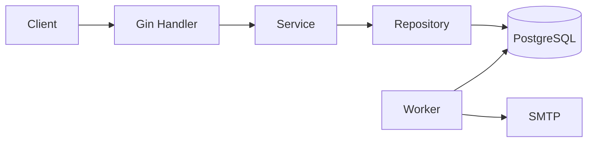
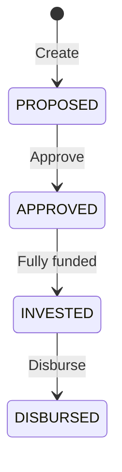

# Loan Service Design

The service manages loans from creation to disbursement. It uses Go, Gin, GORM, and PostgreSQL.

## Menu

- [1. App structure](#1-app-structure)
- [2. Loan states](#2-loan-states)
- [3. Create, approve, and disburse](#3-create-approve-and-disburse)
- [4. Investment flow](#4-investment-flow)
- [5. Duplicate requests](#5-duplicate-requests)
- [6. Email tasks](#6-email-tasks)
- [7. Data and migrations](#7-data-and-migrations)
- [8. Auth and logs](#8-auth-and-logs)
- [9. Startup and config](#9-startup-and-config)
- [10. Tests](#10-tests)
- [11. Limits](#11-limits)

## 1. App structure

The app has one codebase and two entry points:

| Entry point | Job |
| --- | --- |
| `cmd/server` | Serve HTTP requests |
| `cmd/worker` | Send loan agreement emails |



| Layer | Job | Code |
| --- | --- | --- |
| Handler | Read input, check input, read user identity, return a response | `internal/handler` |
| Service | Apply business rules and manage transactions | `internal/service` |
| Repository | Read and write tables with GORM | `internal/repository` |
| Model | Define table fields and loan states | `internal/model` |
| Middleware | Check auth and roles, add request logs and trace data | `internal/middleware` |

Each table has its own repository. A service transaction gives all repositories the same transaction connection. If any step fails, all writes in that transaction roll back.

## 2. Loan states



| Action | Required state | Result |
| --- | --- | --- |
| Create | No loan yet | Create a `PROPOSED` loan |
| Approve | `PROPOSED` | Set `APPROVED` |
| Invest | `APPROVED` | Keep `APPROVED` until the loan is full, then set `INVESTED` |
| Disburse | `INVESTED` | Set `DISBURSED` |

A new action in the wrong state returns `ErrState`. An exact investment retry returns its saved result, even if the loan state has since changed.

## 3. Create, approve, and disburse

| Action | Writes in one transaction | Concurrency control |
| --- | --- | --- |
| Create | Loan and `CREATE` history | Unique loan number |
| Approve | Status, approval record, and `APPROVE` history | Update only when the current status is `PROPOSED` |
| Disburse | Disbursement record, status, and `DISBURSE` history | Lock the loan row and require `INVESTED` |

The create handler requires a positive principal. Rate and ROI must be between 0 and 100. ROI must not exceed Rate.

Approval and disbursement use the staff ID from auth. The service sets `ApprovedAt` and `DisbursedAt` with `time.Now().UnixMilli()`. Client fields cannot replace these values.

Two requests cannot approve or disburse the same loan twice through these service methods. One succeeds; the other returns `ErrState`.

## 4. Investment flow

Each investment runs in one database transaction:

1. Lock the loan with `SELECT ... FOR UPDATE`.
2. Look up the idempotency key.
3. Return the saved result for an exact retry. Reject changed request data.
4. Require `APPROVED`, a positive amount, and enough remaining principal.
5. Insert the investment.
6. Update the loan's invested amount and status.
7. Save the response JSON for future retries.
8. If the loan is full, write `FULLY_FUNDED` history and email tasks.
9. Commit all writes together.

Requests for the same loan wait for the same row lock. Each request reads the latest committed balance before it adds money. This prevents over-investment and lost updates through the service.

If any write fails, the investment, loan update, history, and email tasks all roll back. Email is sent later, outside this transaction.

## 5. Duplicate requests

The investment endpoint requires an `Idempotency-Key` header. The key is unique across all investments, including investments in different loans.

| Request | Result |
| --- | --- |
| New key and valid input | Create one investment and save its response |
| Same key, loan, investor, email, and amount | Return the saved response; add no rows |
| Same key with changed data | Return `ErrIdempotency` |
| Same key used at once for different loans | The database unique index picks one winner; the other returns `ErrIdempotency` |

Requests for the same loan use the loan row lock. Requests for different loans use different locks, so the unique key index handles their key conflict. The repository maps that specific unique index error to `ErrIdempotency`.

## 6. Email tasks

When a loan becomes full, the service adds one Outbox task per investor. Several investments by the same investor produce one task for that loan and notification type.

The worker uses this flow:

1. Claim a ready task with atomic SQL and `FOR UPDATE SKIP LOCKED`.
2. Set a random lease token and move `available_at` forward by 60 seconds.
3. Send the email with a 10-second timeout.
4. On success, set `delivered_at` and clear the token.
5. On failure, clear the token and delay the next attempt.

The retry delay is `min(attempts, 60) * 10` seconds. An expired lease allows another worker to claim the task. Complete and retry updates must match the current token, so an old worker cannot change a newer lease.

The current SQL uses `available_at` for both retry time and lease expiry. The model also has `lease_until`, but the worker does not use it.

Email delivery is **at least once**. A crash after sending but before saving success can cause another email. A stable Message-ID helps identify duplicates, but does not guarantee one delivery.

## 7. Data and migrations

| Table | Stores |
| --- | --- |
| `loans` | Loan number, borrower, amounts, rates, agreement URL, and status |
| `approvals` | Loan number, staff ID, visit proof URL, and approval time |
| `investments` | Investor, amount, unique request key, and saved response |
| `disbursements` | Loan number, staff ID, signed agreement URL, and disbursement time |
| `loan_status_history` | Previous state, new state, action, and time |
| `notification_outbox` | Email tasks, attempts, lease data, and delivery time |

Data types and rules:

- `loan_no` is a 22-character string used in API paths and table links.
- Internal row IDs use PostgreSQL `BIGSERIAL` and Go `int64`.
- Amounts use `int64`. Rate and ROI use `numeric(10,6)` and Go decimals.
- App timestamps use Unix milliseconds.
- `remaining_amount` is not stored. It is principal minus invested amount. The current loan model does not have a hook that fills this field after a read.
- Handlers return small response types for loan creation and investment. Hidden model fields use `json:"-"`.

Unique indexes protect loan numbers, investment keys, one disbursement per loan, and one Outbox task per loan/investor/type. Other business checks, such as valid states and investment limits, run in the handler or service. The current migration does not add foreign keys or CHECK constraints for these rules. Direct table writes can bypass them.

SQL files in `migrations` manage the schema. The app does not call `AutoMigrate` at startup. Compose runs only `001_init.up.sql` when it first creates the database volume. An existing volume needs an explicit migration step. `001_init.down.sql` drops tables and is for an intentional manual rollback only.

## 8. Auth and logs

Business routes require a Bearer token. The current auth code maps configured tokens to trusted identities.

| Role | Allowed actions |
| --- | --- |
| Staff | Create, approve, and disburse loans |
| Investor | Invest in loans |

Staff IDs, investor IDs, and investor emails come from auth. The service does not trust these values from request JSON.

Handlers use the shared response format in `api/v1`. Public errors have HTTP status codes and business codes. Internal errors return a general message without database details.

Zap logs use request context for request and trace data. GORM SQL logs are off to avoid logging business values. `/healthz` checks the HTTP process; `/readyz` checks the database connection.

## 9. Startup and config

`config.NewConfig` reads one YAML file. The default is `config/local.yml`. The server and worker accept `-conf` to choose another file. Files are not merged, and environment variables do not replace their values.

Google Wire builds the dependencies in `cmd/server/wire` and `cmd/worker/wire`. Constructors use `New...` functions and provider sets. Cleanup functions close database connections and flush tracing. The server handles shutdown signals and stops HTTP requests cleanly.

`repository.NewDB` opens and checks the PostgreSQL connection pool. GORM `WithContext` passes request cancellation and deadlines to database calls.

## 10. Tests

| Test type | Dependencies | Main checks |
| --- | --- | --- |
| Unit | No database; stubs where needed | Input rules, amount and state calculation, key lookup, error responses |
| Integration | Real PostgreSQL | Transactions, concurrent requests, unique keys, final rows, HTTP auth, and Outbox leases |

Integration tests use the existing database from `config/local.yml`. They do not create another database. Each test creates a random schema, applies the SQL migrations there, closes its connections, and removes only that schema.

Concurrent service calls use separate transactions from the connection pool. Tests use start channels and wait groups, not sleeps. They check final amounts, states, record counts, history, and Outbox rows. Failure tests add constraints only to their own test tables to check rollback. Email tests use a fake sender.

Run from the project root:

```sh
# Unit tests, with step logs
go test -v ./...

# Unit tests with race checks
go test -race ./...

# PostgreSQL tests, with step logs and race checks
go test -tags=integration -v -race -count=1 -timeout=120s ./tests/integration

# One approval rollback test
go test -tags=integration -v ./tests/integration -run '^TestApproveRecordFailureRollsBack$'
```

GoLand needs `integration` in its custom build tags to show integration test files as active. Saved run configs in `.run` include the tag and verbose output.

## 11. Limits

The current app does not include:

- A production identity provider.
- Agreement file creation or object storage.
- Real money transfers, repayments, or currency conversion.
- Redis, an external message queue, or automatic scaling.
- A guarantee that an email reaches the inbox exactly once.

Real SMTP delivery, process crashes during email delivery, and a full migration/model comparison still need more test coverage.
